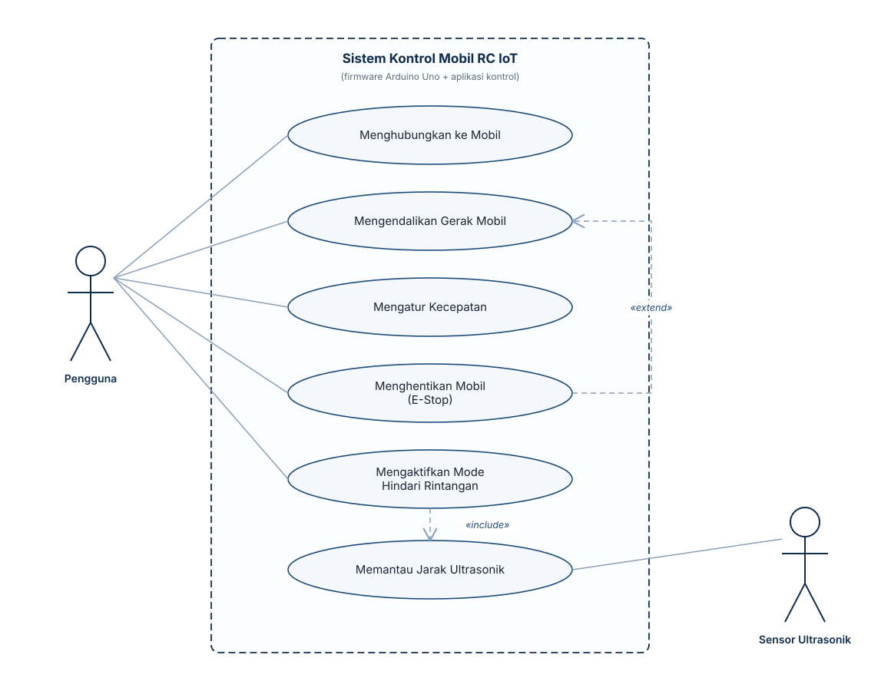

# Software Requirements Specification

## 1. Pendahuluan

### 1.1 Tujuan Dokumen

Dokumen ini merupakan *Software Requirements Specification* (SRS) untuk Sistem
Kontrol Mobil RC IoT yang dikembangkan oleh tim Ecayci Lover. Dokumen menjabarkan
kebutuhan fungsional, kebutuhan non-fungsional, serta pemodelan *use case*
sebagai acuan tunggal bagi pengembang dalam menulis dan menguji firmware.
Struktur dokumen mengikuti kerangka umum IEEE 830 yang disederhanakan agar sesuai
dengan skala proyek mata kuliah.

### 1.2 Ruang Lingkup Produk

Produk yang dibangun adalah firmware yang berjalan pada mikrokontroler Arduino
Uno yang dipasangkan Arduino Shield V5.0, dan mengendalikan dua motor DC melalui
motor driver L298N. Mobil dikendalikan secara nirkabel melalui Bluetooth
menggunakan modul HC-05 dan dilengkapi sensor ultrasonic untuk membaca jarak
objek di depan mobil.

Fokus pengembangan adalah perangkat lunak (firmware). Perangkat keras yang
digunakan, yaitu Arduino Uno, Arduino Shield V5.0, L298N, dua motor DC, HC-05,
sensor ultrasonic, dan baterai, telah tersedia dan berfungsi.

### 1.3 Definisi, Akronim, dan Singkatan

Istilah-istilah yang digunakan dalam dokumen ini dijelaskan pada Tabel 1.1.

Tabel 1.1 Daftar Istilah dan Singkatan
{: .table-caption }

| Istilah | Keterangan |
|---------|------------|
| Firmware | Perangkat lunak yang ditanamkan pada mikrokontroler dalam bentuk sketch `.ino` |
| PWM | *Pulse Width Modulation*, teknik mengatur kecepatan motor melalui `analogWrite()` |
| L298N | Modul *dual H-bridge* sebagai driver dua motor DC |
| HC-05 | Modul Bluetooth klasik (SPP) untuk komunikasi serial nirkabel |
| Ultrasonic | Sensor jarak HC-SR04 dengan pin Trig dan Echo |
| E-Stop | *Emergency Stop*, perintah menghentikan seluruh motor seketika |
| UML | *Unified Modeling Language*, notasi pemodelan *use case* |
| SRS | *Software Requirements Specification* |

### 1.4 Referensi

Referensi yang digunakan dalam penyusunan dokumen ini adalah sebagai berikut.

1. Dokumen profil tim Ecayci Lover (`docs/tugas-1-profil-tim.md`).
2. Catatan kebutuhan perangkat keras pada repositori proyek (`firmware/README.md`).
3. Datasheet Arduino Uno (ATmega328P) dan modul driver L298N.

### 1.5 Ikhtisar Dokumen

Bagian 2 menjelaskan gambaran umum produk. Bagian 3 memuat kebutuhan fungsional,
Bagian 4 memuat kebutuhan non-fungsional, dan Bagian 5 memuat pemodelan *use
case* beserta deskripsi rincinya. Bagian 6 menjelaskan antarmuka dan protokol
perintah, sedangkan Bagian 7 memuat batasan dan asumsi tambahan.

## 2. Deskripsi Umum

### 2.1 Perspektif Produk

Sistem merupakan produk mandiri (*stand-alone embedded system*) yang tidak
bergantung pada server. Mobil berkomunikasi langsung (*point-to-point*) dengan
aplikasi kontrol pengguna melalui Bluetooth. Arsitektur tingkat tinggi sistem
digambarkan sebagai berikut.

```
[Aplikasi Kontrol Pengguna]  (smartphone / PC)
            |
            |  Bluetooth (SPP, HC-05)
            v
+---------------------------------------------------+
|             ARDUINO UNO + SHIELD V5.0             |
|                                                   |
|  Firmware: parsing perintah -> kontrol motor       |
|            baca sensor ultrasonic -> laporan       |
+---------------------------------------------------+
        |                              |
        | PWM + arah (IN1-IN4, ENA/ENB) | Trig / Echo
        v                              v
   [ MOTOR DRIVER L298N ]        [ SENSOR ULTRASONIC ]
        |                              |
        v                          (jarak objek)
   [ 2x MOTOR DC ]  <- [ BATERAI + SUPLAI EKSTERNAL ]
```

### 2.2 Fungsi Produk

Fungsi utama yang disediakan sistem adalah sebagai berikut.

1. **Koneksi**, menyediakan jalur komunikasi Bluetooth antara pengguna dan mobil.
2. **Kontrol gerak**, mengendalikan arah gerak mobil, yaitu maju, mundur, belok
   kiri, dan belok kanan.
3. **Kontrol kecepatan**, mengatur kecepatan motor melalui PWM.
4. **Berhenti darurat**, menghentikan seluruh motor seketika (*E-Stop*).
5. **Mode hindari rintangan**, menghentikan atau membelokkan mobil secara
   otomatis ketika terdapat rintangan.
6. **Telemetri jarak**, mengirimkan hasil pembacaan sensor ultrasonic kepada
   pengguna.

### 2.3 Karakteristik Pengguna

Karakteristik pengguna sistem disajikan pada Tabel 2.1.

Tabel 2.1 Karakteristik Pengguna
{: .table-caption }

| Pengguna | Karakteristik |
|----------|---------------|
| Pengguna umum | Dapat mengoperasikan smartphone, tanpa pengetahuan teknis khusus |
| Pengembang | Memahami dasar mikrokontroler, rangkaian, dan bahasa C/C++ Arduino |

### 2.4 Batasan

Batasan yang harus dipatuhi dalam pengembangan sistem adalah sebagai berikut.

1. **Mikrokontroler** yang digunakan adalah Arduino Uno (ATmega328P) dengan
   kapasitas 32 KB flash dan 2 KB SRAM, sehingga tidak boleh menggunakan
   pustaka berukuran besar.
2. **Logika sistem** berjalan pada 5 V, sehingga tidak boleh menulis kode khusus
   3,3 V.
3. **PWM** hanya tersedia pada pin 3, 5, 6, 9, 10, dan 11, serta hanya dapat
   diakses melalui fungsi `analogWrite()`. Fungsi `ledcSetup` dan `ledcWrite`
   yang khusus untuk ESP32 tidak boleh digunakan.
4. **Komponen yang tidak dipakai** adalah I2C, sensor infrared (IR), dan LCD,
   sehingga tidak boleh ditambahkan kode, pin, maupun pustaka untuk ketiganya.
5. **Kredensial** berupa PIN Bluetooth tidak boleh di-commit ke repositori dan
   harus disimpan pada berkas `secrets.h` yang diabaikan Git.
6. **Daya** motor wajib disuplai dari sumber eksternal, dan GND Arduino harus
   disatukan dengan GND L298N.

### 2.5 Asumsi dan Ketergantungan

Asumsi yang digunakan dalam penyusunan kebutuhan adalah sebagai berikut.

1. Modul Bluetooth yang dipakai adalah HC-05 sesuai kit yang tersedia.
2. Kit belum menyediakan modul WiFi, sehingga kebutuhan WiFi bersifat opsional
   dan menunggu konfirmasi lingkup dari dosen pengampu.
3. Nilai pin, baud rate, dan nilai PWM final ditentukan pada saat integrasi
   perangkat keras dan dicatat pada `firmware/README.md`.

## 3. Kebutuhan Fungsional

Kebutuhan fungsional diberi kode FR-xx dengan prioritas menggunakan skala
MoSCoW, yaitu *Must*, *Should*, dan *Could*. Daftar lengkap kebutuhan fungsional
disajikan pada Tabel 3.1.

Tabel 3.1 Daftar Kebutuhan Fungsional
{: .table-caption }

| Kode | Kebutuhan | Prioritas |
|------|-----------|-----------|
| FR-01 | Sistem harus menyediakan koneksi Bluetooth dan menerima perintah dari aplikasi pengguna. | Must |
| FR-02 | Sistem harus dapat menggerakkan mobil maju dan mundur. | Must |
| FR-03 | Sistem harus dapat membelokkan mobil ke kiri dan ke kanan. | Must |
| FR-04 | Sistem harus dapat menghentikan seluruh motor melalui perintah stop. | Must |
| FR-05 | Sistem harus dapat mengatur kecepatan motor melalui nilai PWM (0–255). | Should |
| FR-06 | Sistem harus dapat mengaktifkan mode hindari rintangan secara otomatis. | Should |
| FR-07 | Sistem harus membaca jarak dari sensor ultrasonic. | Must |
| FR-08 | Sistem harus mengirimkan data jarak hasil pembacaan ke aplikasi pengguna. | Should |
| FR-09 | Sistem harus menghentikan motor seketika saat perintah E-Stop diterima. | Must |
| FR-10 | Sistem harus mengabaikan perintah tidak dikenal tanpa mengubah kondisi motor. | Must |
| FR-11 | Sistem harus menghentikan motor secara aman jika koneksi Bluetooth terputus. | Should |
| FR-12 | Sistem harus mengirimkan status atau konfirmasi perintah yang diterima. | Could |

### 3.1 Rincian Kebutuhan Fungsional Utama

Penjelasan rinci untuk kebutuhan fungsional utama adalah sebagai berikut.

**FR-02 dan FR-03, Kontrol Gerak.** Sistem mengendalikan arah putaran tiap motor
dengan mengatur pin arah (IN1 sampai IN4) pada L298N. Gerak maju dan mundur
menggerakkan kedua motor secara sinkron, sedangkan gerak belok kiri dan belok
kanan dicapai dengan membalik arah salah satu motor.

**FR-05, Kontrol Kecepatan.** Kecepatan diatur melalui fungsi `analogWrite()`
pada pin ENA dan ENB. Nilai 0 berarti berhenti dan nilai 255 berarti kecepatan
maksimum. Nilai default kecepatan ditetapkan pada konstanta `SPEED_DEFAULT`.

**FR-06 dan FR-07, Hindari Rintangan.** Ketika mode ini aktif, sistem membaca
jarak dari sensor ultrasonic secara berkala. Apabila jarak kurang dari ambang
batas yang ditentukan, sistem menghentikan atau membelokkan mobil untuk mencegah
tabrakan.

**FR-09, E-Stop.** Perintah E-Stop diproses dengan prioritas tertinggi dan
langsung memanggil prosedur penghentian seluruh motor.

## 4. Kebutuhan Non-Fungsional

Kebutuhan non-fungsional diberi kode NFR-xx dan disajikan pada Tabel 4.1.

Tabel 4.1 Daftar Kebutuhan Non-Fungsional
{: .table-caption }

| Kode | Kategori | Kebutuhan |
|------|----------|-----------|
| NFR-01 | Kinerja | Sistem merespons perintah gerak dalam waktu kurang dari 200 ms sejak perintah diterima. |
| NFR-02 | Kinerja | Loop utama berjalan tanpa *blocking delay* panjang agar kontrol tetap responsif. |
| NFR-03 | Keandalan | Motor berhenti otomatis saat koneksi Bluetooth terputus. |
| NFR-04 | Keandalan | Perintah tidak dikenal tidak menyebabkan perilaku tak terduga. |
| NFR-05 | Efisiensi Sumber Daya | Penggunaan flash kurang dari 60 persen dan SRAM kurang dari 60 persen dari kapasitas Arduino Uno. |
| NFR-06 | Portabilitas | Firmware dikompilasi untuk board Arduino Uno melalui Arduino IDE. |
| NFR-07 | Keamanan | Kredensial tidak disimpan di dalam repositori dan diabaikan Git. |
| NFR-08 | Kemudahan Perawatan | Kode termodulasi, yaitu fungsi kontrol motor, transport, dan sensor dipisahkan. |
| NFR-09 | Kegunaan | Protokol perintah sederhana, yaitu satu karakter per perintah, agar mudah diuji. |
| NFR-10 | Dokumentasi | Setiap pin, nilai PWM, dan perintah didokumentasikan pada `firmware/README.md`. |

## 5. Pemodelan Use Case

### 5.1 Diagram Use Case

Diagram *use case* sistem disajikan pada Gambar 5.1. Aktor utama adalah
Pengguna, sedangkan Sensor Ultrasonik diperlakukan sebagai aktor pendukung karena
menyediakan data jarak bagi sistem.



Gambar 5.1 Diagram Use Case Sistem Kontrol Mobil RC IoT
{: .figure-caption }

### 5.2 Daftar Use Case

Daftar *use case* beserta aktor dan prioritasnya disajikan pada Tabel 5.1.

Tabel 5.1 Daftar Use Case
{: .table-caption }

| Kode | Use Case | Aktor | Prioritas |
|------|----------|-------|-----------|
| UC-01 | Menghubungkan ke Mobil | Pengguna | Must |
| UC-02 | Mengendalikan Gerak Mobil | Pengguna | Must |
| UC-03 | Mengatur Kecepatan | Pengguna | Should |
| UC-04 | Menghentikan Mobil (E-Stop) | Pengguna | Must |
| UC-05 | Mengaktifkan Mode Hindari Rintangan | Pengguna | Should |
| UC-06 | Memantau Jarak Ultrasonik | Pengguna, Sensor Ultrasonik | Must |

### 5.3 Relasi Antar Use Case

Relasi yang menghubungkan antar *use case* adalah sebagai berikut.

1. **UC-05 «include» UC-06**, yaitu mengaktifkan mode hindari rintangan selalu
   memerlukan pembacaan jarak ultrasonic.
2. **UC-04 «extend» UC-02**, yaitu penghentian darurat (E-Stop) memperluas
   skenario pengendalian gerak ketika dibutuhkan.

### 5.4 Deskripsi Rinci Use Case

Deskripsi rinci untuk masing-masing *use case* diuraikan pada Tabel 5.2 sampai
Tabel 5.7.

Tabel 5.2 Deskripsi Use Case UC-01 Menghubungkan ke Mobil
{: .table-caption }

| Atribut | Keterangan |
|---------|------------|
| Aktor | Pengguna |
| Prakondisi | Mobil menyala dan modul HC-05 dalam kondisi *pairing* |
| Pascakondisi | Koneksi Bluetooth terbentuk dan siap menerima perintah |
| Skenario utama | 1) Pengguna mengaktifkan Bluetooth; 2) Pengguna memilih perangkat mobil; 3) Koneksi terbentuk; 4) Sistem siap menerima perintah |
| Skenario alternatif | 3a) Koneksi gagal, sehingga pengguna mengulang proses *pairing* |

Tabel 5.3 Deskripsi Use Case UC-02 Mengendalikan Gerak Mobil
{: .table-caption }

| Atribut | Keterangan |
|---------|------------|
| Aktor | Pengguna |
| Prakondisi | Koneksi Bluetooth aktif (UC-01) |
| Pascakondisi | Mobil bergerak sesuai arah yang diperintahkan |
| Skenario utama | 1) Pengguna menekan tombol arah; 2) Aplikasi mengirim perintah; 3) Sistem menetapkan pin arah motor; 4) Motor bergerak |
| Skenario alternatif | 3a) Perintah tidak dikenal, sehingga sistem mengabaikannya (FR-10); 3b) Koneksi terputus, sehingga sistem menghentikan motor (FR-11) |

Tabel 5.4 Deskripsi Use Case UC-03 Mengatur Kecepatan
{: .table-caption }

| Atribut | Keterangan |
|---------|------------|
| Aktor | Pengguna |
| Prakondisi | Mobil dalam keadaan bergerak atau siap bergerak |
| Pascakondisi | Nilai PWM motor berubah sesuai pilihan pengguna |
| Skenario utama | 1) Pengguna menggeser pengatur kecepatan; 2) Aplikasi mengirim nilai; 3) Sistem memanggil `analogWrite()` pada ENA dan ENB; 4) Kecepatan motor berubah |

Tabel 5.5 Deskripsi Use Case UC-04 Menghentikan Mobil (E-Stop)
{: .table-caption }

| Atribut | Keterangan |
|---------|------------|
| Aktor | Pengguna |
| Prakondisi | Mobil sedang bergerak |
| Pascakondisi | Seluruh motor berhenti |
| Skenario utama | 1) Pengguna menekan tombol E-Stop; 2) Sistem memanggil prosedur penghentian; 3) Seluruh motor berhenti |
| Catatan | Diperlakukan sebagai *extend* terhadap UC-02 dan diproses dengan prioritas tertinggi |

Tabel 5.6 Deskripsi Use Case UC-05 Mengaktifkan Mode Hindari Rintangan
{: .table-caption }

| Atribut | Keterangan |
|---------|------------|
| Aktor | Pengguna |
| Prakondisi | Koneksi aktif dan sensor ultrasonic berfungsi |
| Pascakondisi | Mobil berhenti atau menghindar secara otomatis saat mendeteksi rintangan |
| Skenario utama | 1) Pengguna mengaktifkan mode; 2) Sistem membaca jarak (UC-06); 3) Jika jarak kurang dari ambang batas, sistem menghentikan atau membelokkan mobil; 4) Jika aman, mobil melanjutkan gerak |
| Relasi | «include» UC-06 |

Tabel 5.7 Deskripsi Use Case UC-06 Memantau Jarak Ultrasonik
{: .table-caption }

| Atribut | Keterangan |
|---------|------------|
| Aktor | Pengguna, Sensor Ultrasonik |
| Prakondisi | Sensor ultrasonic terpasang dan terhubung |
| Pascakondisi | Nilai jarak diperoleh dan, bila diminta, dikirim kepada pengguna |
| Skenario utama | 1) Sistem memicu pin Trig; 2) Sistem mengukur durasi pantulan pada pin Echo; 3) Sistem menghitung jarak; 4) Sistem mengirim atau menggunakan nilai jarak |
| Skenario alternatif | 3a) Pembacaan tidak valid, sehingga sistem mengabaikan nilai tersebut |

## 6. Antarmuka dan Protokol Perintah

### 6.1 Antarmuka Komunikasi

Komunikasi menggunakan Bluetooth SPP melalui modul HC-05 yang diakses sebagai
*serial port*. Setiap perintah direpresentasikan sebagai satu karakter.

### 6.2 Rancangan Protokol Perintah

Rancangan awal protokol perintah disajikan pada Tabel 6.1. Nilai final protokol,
termasuk baud rate dan pin, masih berstatus belum ditetapkan dan akan
difinalkan pada saat integrasi perangkat keras. Rancangan ini menjadi acuan awal
pengujian.

Tabel 6.1 Rancangan Protokol Perintah
{: .table-caption }

| Perintah | Karakter | Aksi |
|----------|----------|------|
| Maju | `F` | Kedua motor maju |
| Mundur | `B` | Kedua motor mundur |
| Kiri | `L` | Belok kiri |
| Kanan | `R` | Belok kanan |
| Stop | `S` | Kedua motor berhenti |
| E-Stop | `X` | Hentikan seluruh motor seketika |
| Mode hindari | `A` | Aktifkan atau nonaktifkan mode hindari rintangan |

### 6.3 Antarmuka Perangkat Keras

Pemetaan antarmuka perangkat keras disajikan pada Tabel 6.2.

Tabel 6.2 Pemetaan Antarmuka Perangkat Keras
{: .table-caption }

| Antarmuka | Pin atau Sinyal | Keterangan |
|-----------|-----------------|------------|
| Motor A | IN1, IN2, ENA | Arah dan PWM motor kiri |
| Motor B | IN3, IN4, ENB | Arah dan PWM motor kanan |
| Bluetooth | Serial (HC-05) | RX dan TX modul pada konektor shield |
| Ultrasonic | Trig, Echo | Pemicu dan pembacaan pantulan |

## 7. Batasan dan Asumsi Tambahan

Beberapa hal yang perlu diperhatikan pada tahap integrasi adalah sebagai berikut.

1. **WiFi belum tersedia.** Kit hanya menyertakan HC-05 dan belum ada modul
   WiFi, sehingga kebutuhan WiFi bersifat opsional dan menunggu konfirmasi.
2. **Daya.** L298N membutuhkan suplai motor sekitar 5 sampai 12 V, sedangkan
   baterai kit bernilai 3,2 V, sehingga kesesuaian daya perlu diverifikasi agar
   motor dapat bergerak.
3. **Pin belum final.** Pemetaan pin, nilai PWM, dan perilaku sensor ultrasonic
   masih berstatus belum ditetapkan dan akan difinalkan pada tahap integrasi.

## 8. Matriks Keterlacakan

Hubungan antara *use case* dan kebutuhan fungsional disajikan pada Tabel 8.1.

Tabel 8.1 Matriks Keterlacakan Use Case terhadap Kebutuhan Fungsional
{: .table-caption }

| Use Case | Kebutuhan Fungsional Terkait |
|----------|------------------------------|
| UC-01 | FR-01 |
| UC-02 | FR-02, FR-03, FR-10 |
| UC-03 | FR-05 |
| UC-04 | FR-04, FR-09 |
| UC-05 | FR-06, FR-11 |
| UC-06 | FR-07, FR-08 |
