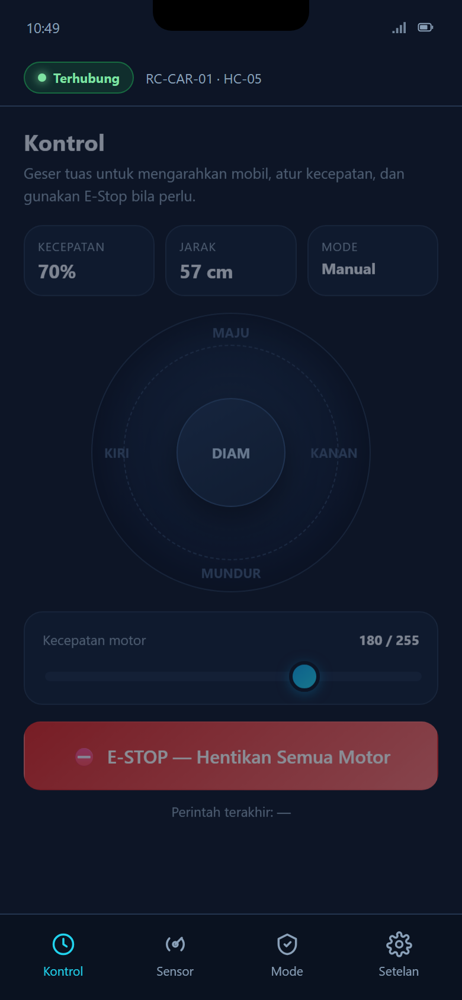
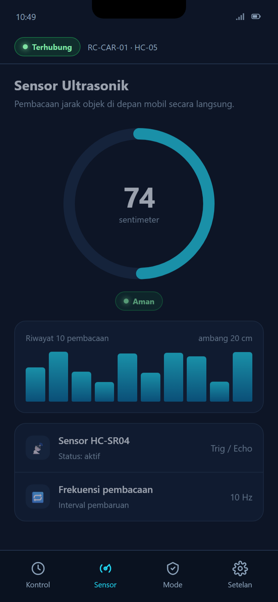

# Wireframe dan Prototype Antarmuka

## 1. Pendahuluan

### 1.1 Latar Belakang

Sistem kontrol mobil RC IoT yang dikembangkan tim Ecayci Lover dikendalikan oleh
pengguna melalui aplikasi pendamping pada telepon pintar. Agar aplikasi tersebut
mudah digunakan, diperlukan rancangan antarmuka yang memperhatikan prinsip
kegunaan (*usability*) dan pengalaman pengguna (*user experience*). Dokumen ini
memaparkan hasil perancangan antarmuka tersebut, mulai dari wireframe tingkat
rendah hingga prototype interaktif tingkat tinggi.

### 1.2 Tujuan

Tujuan penyusunan dokumen ini adalah sebagai berikut.

1. Menyediakan wireframe tingkat rendah sebagai dasar penyusunan tata letak.
2. Menyediakan prototype interaktif yang menerapkan prinsip UI/UX yang baik.
3. Memastikan rancangan antarmuka selaras dengan kebutuhan sistem yang telah
   didefinisikan pada dokumen SRS.

### 1.3 Ruang Lingkup

Rancangan antarmuka pada dokumen ini mencakup lima layar utama aplikasi, yaitu
layar Hubungkan, Kontrol, Sensor, Mode, dan Setelan. Setiap layar dipetakan
terhadap *use case* yang relevan sebagaimana dijelaskan pada Bagian 6.

## 2. Berkas Hasil Rancangan

Hasil rancangan terdiri atas dua berkas yang dapat dibuka langsung pada
peramban tanpa pemasangan perangkat lunak tambahan. Kedua berkas tersebut
diuraikan pada Tabel 2.1.

Tabel 2.1 Berkas Hasil Rancangan Antarmuka
{: .table-caption }

| Berkas | Deskripsi |
|--------|-----------|
| `docs/tugas-3-prototype/wireframe.html` | Lembar wireframe tingkat rendah yang memuat lima layar |
| `docs/tugas-3-prototype/index.html` | Prototype interaktif tingkat tinggi yang dapat diklik |

## 3. Alur Pengguna

Alur penggunaan aplikasi dimulai dari layar Hubungkan, kemudian berlanjut ke
layar Kontrol, Sensor, Mode, dan diakhiri pada layar Setelan. Pengguna harus
menyelesaikan proses pada layar Hubungkan terlebih dahulu. Sebelum koneksi
terbentuk, navigasi ke layar lain dibatasi dan pengguna diberi umpan balik
berupa pesan singkat.

```
   [ Hubungkan ]  -->  [ Kontrol ]  -->  [ Sensor ]  -->  [ Mode ]  -->  [ Setelan ]
      UC-01            UC-02/03/04        UC-06           UC-05
```

## 4. Wireframe Tingkat Rendah

Wireframe tingkat rendah menampilkan lima layar utama beserta struktur dan
hierarki kontennya. Warna, ikon final, dan detail visual sengaja dihilangkan
agar penilaian terfokus pada tata letak dan alur. Lembar wireframe disajikan
pada Gambar 4.1.


Gambar 4.1 Lembar Wireframe Tingkat Rendah
{: .figure-caption }

Elemen yang dipertahankan pada seluruh layar adalah sebagai berikut.

1. **Header status koneksi** yang selalu tampil dan menunjukkan keadaan
   terhubung atau terputus.
2. **Navigasi tab bawah** dengan empat tujuan utama yang selalu tersedia.
3. **Tata letak satu kolom** dengan pendekatan *mobile-first*.

## 5. Prototype Tingkat Tinggi

Prototype menerapkan tema gelap (*dark cockpit*) agar nyaman digunakan di luar
ruangan dan membuat indikator status lebih menonjol. Kelima layar utama
prototype disajikan pada Gambar 5.1.


Gambar 5.1 Lembar Prototype Tingkat Tinggi
{: .figure-caption }

### 5.1 Layar Hubungkan (UC-01)

Layar ini menampilkan daftar perangkat Bluetooth yang tersedia beserta kekuatan
sinyalnya. Pengguna memilih perangkat yang dituju, kemudian menekan tombol
Hubungkan.

### 5.2 Layar Kontrol (UC-02, UC-03, UC-04)

Layar Kontrol merupakan layar utama aplikasi. Layar ini memuat tuas arah
(*joystick*) untuk mengendalikan gerak, penggeser kecepatan, kartu informasi
singkat yang menampilkan kecepatan, jarak, dan mode, serta tombol E-Stop
berwarna merah yang paling menonjol. Tampilan lebih besar untuk layar ini
disajikan pada Gambar 5.2.



Gambar 5.2 Detail Layar Kontrol
{: .figure-caption }

### 5.3 Layar Sensor (UC-06)

Layar Sensor menampilkan jarak objek secara langsung melalui indikator melingkar
(*gauge*), status aman, waspada, atau bahaya, serta riwayat sepuluh pembacaan
terakhir. Tampilan lebih besar untuk layar ini disajikan pada Gambar 5.3.



Gambar 5.3 Detail Layar Sensor
{: .figure-caption }

### 5.4 Layar Mode (UC-05)

Layar Mode berfungsi untuk mengaktifkan mode hindari rintangan dan mengatur
ambang batas jarak yang memicu penghentian otomatis.

### 5.5 Layar Setelan

Layar Setelan memuat informasi koneksi, preferensi aplikasi, dan tombol untuk
memutuskan koneksi.

## 6. Prinsip UI/UX yang Diterapkan

Prinsip UI/UX yang diterapkan pada rancangan beserta bentuk penerapannya
disajikan pada Tabel 6.1.

Tabel 6.1 Prinsip UI/UX dan Penerapannya
{: .table-caption }

| Prinsip | Penerapan |
|---------|-----------|
| Konsistensi | Warna, radius sudut, tipografi, dan gaya ikon seragam di seluruh layar |
| Umpan balik | Tombol dan tuas bereaksi seketika serta menampilkan pesan konfirmasi perintah |
| Hierarki visual | Tombol E-Stop berwarna merah paling menonjol dan informasi penting ditempatkan di bagian atas layar |
| Visibilitas status | Status koneksi selalu tampil pada header di setiap layar |
| Target sentuh | Seluruh tombol berukuran minimal 48 piksel agar mudah ditekan |
| Pencegahan kesalahan | Tombol E-Stop bersifat khusus dan navigasi dibatasi saat belum terhubung |
| Aksesibilitas | Kontras teks tinggi dan makna tidak disampaikan hanya melalui warna |
| Efisiensi | Navigasi tab bawah serta aksi utama dapat dicapai dalam satu ketukan |

## 7. Desain Responsif

Rancangan antarmuka menerapkan desain responsif dengan ketentuan sebagai
berikut.

1. **Pendekatan mobile-first**, yaitu dirancang untuk layar berukuran 390 kali
   844 piksel.
2. **Tata letak berbasis persentase dan flexbox**, sehingga elemen menyesuaikan
   lebar layar.
3. **Grid adaptif pada lembar wireframe**, yaitu lima kolom pada layar lebar dan
   menyusut menjadi tiga, dua, hingga satu kolom pada layar kecil.
4. **Satuan relatif dan rasio aspek**, sehingga proporsi tuas dan indikator
   tetap terjaga pada berbagai ukuran layar.

## 8. Palet Warna dan Tipografi

Palet warna yang digunakan pada prototype beserta perannya disajikan pada
Tabel 8.1. Tipografi yang digunakan adalah keluarga huruf tanpa kait
(*sans-serif*), yaitu Segoe UI atau Inter, dengan ukuran 10 sampai 30 poin dan
hierarki yang jelas.

Tabel 8.1 Palet Warna Prototype
{: .table-caption }

| Peran | Warna | Keterangan |
|-------|-------|------------|
| Latar | #0d1526 | Tema gelap, nyaman untuk penggunaan di luar ruangan |
| Aksen utama | #0ea5e9 | Tombol utama dan elemen aktif |
| Aksen sekunder | #22d3ee | Sorotan dan indikator |
| Aman | #22c55e | Status jarak aman |
| Waspada | #f59e0b | Status jarak waspada |
| Bahaya | #ef4444 | Tombol E-Stop dan status bahaya |

## 9. Keterkaitan dengan Use Case

Keterkaitan antara layar rancangan dan *use case* pada dokumen SRS disajikan
pada Tabel 9.1.

Tabel 9.1 Keterkaitan Layar dengan Use Case
{: .table-caption }

| Use Case | Layar atau Elemen |
|----------|-------------------|
| UC-01 Menghubungkan ke Mobil | Layar Hubungkan |
| UC-02 Mengendalikan Gerak Mobil | Tuas arah pada layar Kontrol |
| UC-03 Mengatur Kecepatan | Penggeser kecepatan pada layar Kontrol |
| UC-04 Menghentikan Mobil (E-Stop) | Tombol E-Stop pada layar Kontrol |
| UC-05 Mengaktifkan Mode Hindari Rintangan | Layar Mode |
| UC-06 Memantau Jarak Ultrasonik | Layar Sensor |

## 10. Catatan Teknis

Beberapa catatan teknis terkait hasil rancangan adalah sebagai berikut.

1. Prototype dibangun menggunakan HTML, CSS, dan JavaScript murni, sehingga
   dapat dibuka langsung tanpa pemasangan alat tambahan dan mudah dipindahkan
   ke perangkat perancangan lain seperti Figma apabila diperlukan.
2. Berkas ini bukan merupakan aplikasi produksi, melainkan purwarupa desain.
   Firmware mobil berada pada direktori `firmware/`.
3. Data jarak yang tampil pada layar Sensor merupakan simulasi. Pada aplikasi
   sesungguhnya, nilai tersebut berasal dari sensor ultrasonic melalui
   komunikasi Bluetooth.
