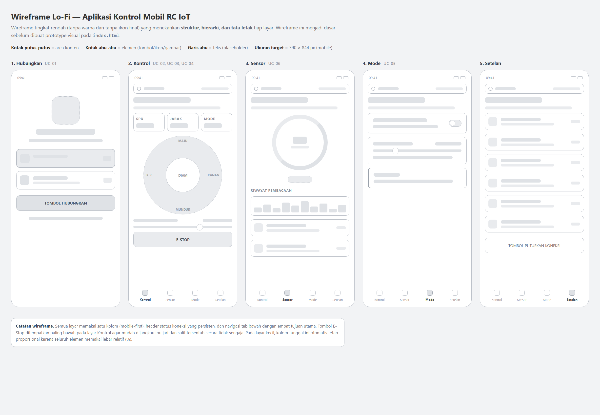
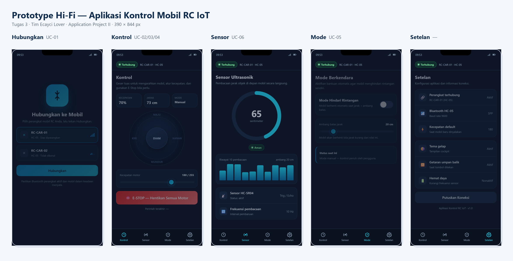
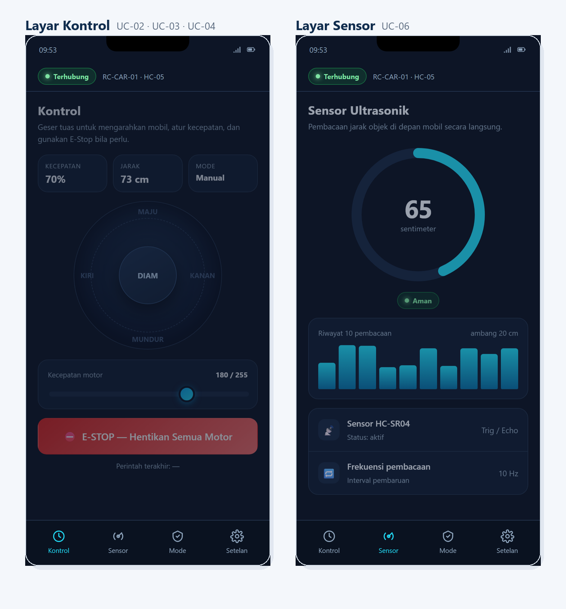

# Wireframe dan Prototype UI/UX

## 1. Ringkasan

Tugas ini menghasilkan rancangan antarmuka untuk **aplikasi kontrol mobil RC IoT**
— aplikasi pendamping (mobile companion app) yang dipakai pengguna untuk
mengendalikan mobil melalui Bluetooth. Rancangan terdiri atas dua tingkat:

1. **Wireframe lo-fi** — fokus pada struktur, hierarki, dan tata letak tanpa warna.
2. **Prototype hi-fi interaktif** — desain visual lengkap yang dapat diklik.

Kedua berkas dapat dibuka langsung di peramban (browser):

| Berkas | Deskripsi | Cara membuka |
|--------|-----------|--------------|
| `wireframe.html` | Lembar wireframe lo-fi (5 layar) | Buka berkas di peramban |
| `index.html` | Prototype hi-fi interaktif | Buka berkas di peramban |

> **Prototype interaktif:** buka `docs/tugas-3-prototype/index.html` di peramban,
> lalu gunakan tombol pada layar atau chip navigasi untuk berpindah layar. Tuas
> arah, penggeser kecepatan, sakelar mode, dan tombol E-Stop semuanya berfungsi.

## 2. Alur Pengguna (User Flow)

```
   [ Hubungkan ]  -->  [ Kontrol ]  -->  [ Sensor ]  -->  [ Mode ]  -->  [ Setelan ]
      UC-01            UC-02/03/04        UC-06           UC-05
```

Pengguna harus menyelesaikan **UC-01 (Hubungkan)** terlebih dahulu. Sebelum
terhubung, navigasi ke layar lain dibatasi dan pengguna diberi umpan balik.

## 3. Wireframe Lo-Fi

Wireframe berikut menampilkan lima layar utama dengan struktur dan hierarki
konten. Warna, ikon final, dan detail visual sengaja dihilangkan agar fokus
penilaian berada pada **tata letak dan alur**.



**Elemen yang dipertahankan pada semua layar:**

- **Header status koneksi** yang persisten (indikator terhubung/terputus).
- **Navigasi tab bawah** dengan empat tujuan utama yang selalu tersedia.
- **Satu kolom (single column)** — pendekatan *mobile-first*.

## 4. Prototype Hi-Fi

Prototype menerapkan tema gelap (*dark cockpit*) agar nyaman dipakai di luar
ruangan dan membuat indikator status lebih menonjol. Berikut kelima layar utama:



### 4.1 Layar Hubungkan (UC-01)

Menampilkan daftar perangkat Bluetooth yang tersedia beserta kekuatan sinyal.
Pengguna memilih perangkat lalu menekan tombol **Hubungkan**.

### 4.2 Layar Kontrol (UC-02, UC-03, UC-04)

Layar utama. Berisi **tuas arah** (joystick) untuk mengendalikan gerak, **penggeser
kecepatan**, kartu informasi singkat (kecepatan, jarak, mode), dan tombol
**E-Stop** berwarna merah yang paling menonjol.

### 4.3 Layar Sensor (UC-06)

Menampilkan jarak objek secara langsung melalui indikator melingkar (*gauge*),
status aman/waspada/bahaya, dan riwayat sepuluh pembacaan terakhir.

### 4.4 Layar Mode (UC-05)

Mengaktifkan **mode hindari rintangan** dan mengatur **ambang batas jarak** pemicu
berhenti otomatis.

### 4.5 Layar Setelan

Informasi koneksi, preferensi aplikasi, dan tombol untuk memutuskan koneksi.

### 4.6 Detail Layar Kontrol dan Sensor

Tampilan lebih besar untuk dua layar yang paling sering dipakai:



## 5. Prinsip UI/UX yang Diterapkan

| Prinsip | Penerapan |
|---------|-----------|
| **Konsistensi** | Warna, radius sudut, tipografi, dan gaya ikon seragam di seluruh layar. |
| **Umpan balik (feedback)** | Tombol dan tuas bereaksi seketika; muncul *toast* konfirmasi perintah. |
| **Hierarki visual** | Tombol E-Stop merah paling menonjol; informasi penting di atas layar. |
| **Visibilitas status** | Status koneksi selalu tampil di header pada setiap layar. |
| **Target sentuh** | Semua tombol berukuran minimal **48 px** agar mudah ditekan. |
| **Pencegahan kesalahan** | Perintah E-Stop butuh tombol khusus; navigasi dibatasi saat belum terhubung. |
| **Aksesibilitas** | Kontras teks tinggi; makna tidak disampaikan lewat warna saja (ada label). |
| **Efisiensi** | Navigasi tab bawah; aksi utama dapat dicapai dalam satu ketukan. |

## 6. Desain Responsif

- **Pendekatan mobile-first** — dirancang untuk layar 390 × 844 px.
- **Tata letak berbasis persentase/flexbox** sehingga elemen menyesuaikan lebar layar.
- **Grid adaptif** pada lembar wireframe: 5 kolom (layar lebar) → 3 → 2 → 1 kolom
  (ponsel), sehingga dokumen tetap terbaca pada ukuran layar apa pun.
- **Satuan relatif** (rem/%) dan `aspect-ratio` menjaga proporsi tuas dan indikator.

## 7. Palet Warna dan Tipografi

| Peran | Warna | Keterangan |
|-------|-------|------------|
| Latar | `#0d1526` | Tema gelap, nyaman untuk penggunaan luar ruangan |
| Aksen utama | `#0ea5e9` | Tombol utama dan elemen aktif |
| Aksen sekunder | `#22d3ee` | Sorotan dan indikator |
| Aman | `#22c55e` | Status jarak aman |
| Waspada | `#f59e0b` | Status jarak waspada |
| Bahaya | `#ef4444` | E-Stop dan status bahaya |

**Tipografi:** Segoe UI / Inter (sans-serif), ukuran 10–30 pt dengan hierarki jelas.

## 8. Keterkaitan dengan Use Case

| Use Case | Layar / Elemen |
|----------|----------------|
| UC-01 Menghubungkan ke Mobil | Layar Hubungkan |
| UC-02 Mengendalikan Gerak Mobil | Tuas arah pada layar Kontrol |
| UC-03 Mengatur Kecepatan | Penggeser kecepatan pada layar Kontrol |
| UC-04 Menghentikan Mobil (E-Stop) | Tombol E-Stop pada layar Kontrol |
| UC-05 Mengaktifkan Mode Hindari Rintangan | Layar Mode |
| UC-06 Memantau Jarak Ultrasonik | Layar Sensor |

## 9. Catatan Teknis

- Prototype dibangun dengan **HTML, CSS, dan JavaScript murni** sehingga dapat
  dibuka langsung tanpa pemasangan alat tambahan, dan mudah dipindahkan ke Figma
  bila diperlukan.
- Berkas ini **tidak** merupakan aplikasi produksi; ia adalah purwarupa desain.
  Firmware mobil berada di direktori `firmware/`.
- Data jarak pada layar Sensor adalah **simulasi**; pada aplikasi nyata nilainya
  berasal dari sensor ultrasonic melalui Bluetooth.

---

*Dokumen ini disusun oleh tim Ecayci Lover untuk mata kuliah Application Project II.*
